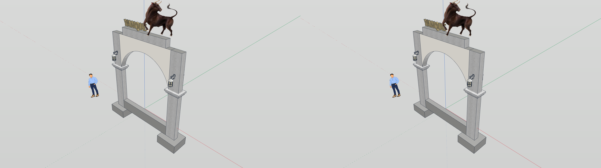
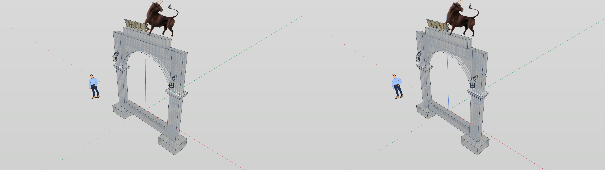

# Stereo view for IngeTrazo

An [IngeTrazo](https://ingetrazo.com) extension that shows the model in stereo 3D, in a view of its own, on desktops that take a stereo declaration ([Stereo KWin](https://github.com/Sparky-OS/sparky-stereo-os), in Sparky Stereo OS).

The modelling stays in IngeTrazo's main viewport, in 2D.
The extension's window shows the same model through two eye cameras, drawn by IngeTrazo's own renderer once per eye, and hands both eyes to the desktop as full side by side: the two eyes next to each other, left eye first, each at its render resolution, declared once through [libstereo-declare](https://github.com/Sparky-OS/libstereo-declare).
The desktop shows each eye to its eye on every kind of 3D screen (a 3D television's HDMI 3D modes, anaglyph on any monitor, interleaved and frame-sequential displays, a headset) and resizes the eyes once, to the window.

Status: a first prototype, built against IngeTrazo 0.5.11 (commit a369d1ed1bf3).

## Options

In **Extensions ▸ Stereo 3D**, three entries and nothing else:

- **Enable 3D** opens and closes the stereo view (remembered between sessions).
- **Render resolution per eye**: *Follow the window* (default), or 720p, 1080p, 1440p, 2160p with the width following the window's shape, so no eye is ever stretched to another shape.
- **Display Settings…** opens KDE's display settings (`kcmshell6 kcm_kscreen`), where each screen's 3D mode, eye order and stereo format are chosen. Those belong to the desktop's outputs, so the extension has none of its own.

The extension draws its own scene, so it offers no eye swap: the definitive swap is the output's, in Display Settings.

## How it works

- `stereo_view/cameras.py`: one world, two cameras. Each eye is the viewport's camera moved sideways along its own right, with parallel axes and the frustum shifted so the plane through the orbit target stays at screen depth (perspective and two-point perspective); a parallel view is sheared about that plane instead. The cameras are one thirtieth of the distance to the target apart. The sun's shadow map is camera independent and is drawn once for both eyes.
- `stereo_view/__init__.py`: the options, the window, and the frames: after each frame of the main viewport, if the camera, the model or the style changed, both eyes are rendered with `Viewport.render_image()` and handed over.
- `stereo_view/layer_wayland.py`: on Wayland, a subsurface of the window carries both eyes in one shared-memory buffer, its `wp_viewport` destination is the window's size, and it is declared full side by side with `stereo_declare_wayland()`. The window itself stays 2D.
- `stereo_view/layer_x11.py`: on X11 (IngeTrazo under xcb), the window is declared with `stereo_declare_x11()` and the desktop makes it hold both eyes; with a render resolution other than the window's, the size one eye is shown at is declared too (`ONE_VIEW_SIZE`), and the desktop's resize proposals are answered.

## Install

Copy the `stereo_view` folder into IngeTrazo's plugins folder (**Extensions ▸ Open plugins folder**, `~/.local/share/ingetrazo/plugins/` on Linux) and restart IngeTrazo.
It needs `libstereo-declare.so.1` and a desktop that announces `kde_stereo_content_manager_v1` (Wayland) or `_KDE_NET_WM_STEREO_CONTENT_SUPPORTED` 3 or later (X11); elsewhere **Enable 3D** says why it is not available and changes nothing.
IngeTrazo's Flatpak cannot reach the host's libraries, so run IngeTrazo from its source or a native package.

## Tests

```sh
INGETRAZO=/path/to/ingetrazo PYTHONPATH=. python3 -m pytest tests
```

The eye cameras are checked against a closed-form prediction in every projection: horizontal disparity, zero vertical disparity, the orbit target at screen depth, near points in front of the screen and far points behind it.

## Licence

GPL-3.0-or-later, as IngeTrazo, whose camera it extends.

## Seen in stereo

IngeTrazo's welcome arch (Yanque), each eye 1920x1080 as handed to the desktop, left eye first; normal style and X-ray style, with the rebar inside the concrete in both eyes.




